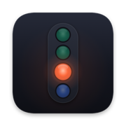
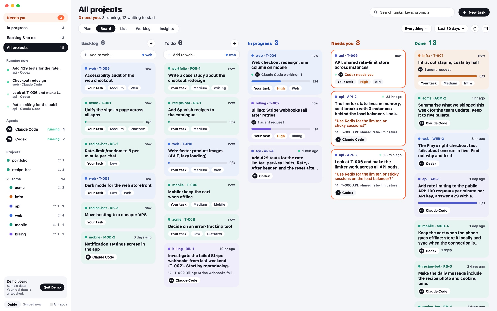
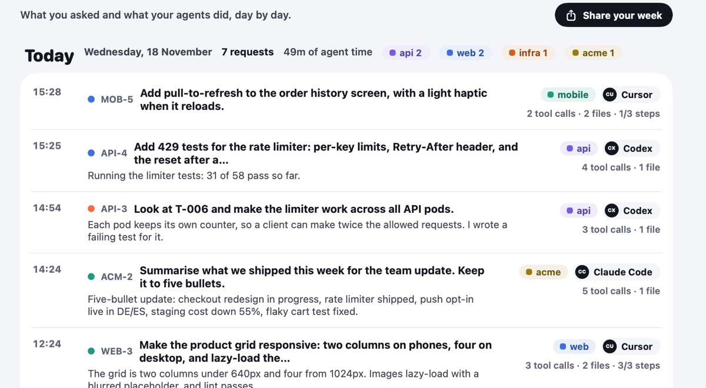

<div align="center">



# ClaudeBoard

### Everything you ask your coding agents, on one board.

A native Mac app that turns your Claude Code and Codex sessions into tickets, next to the tasks you
plan for each project. See what each agent is working on, what it finished, and which ones are
waiting on you, then hand the next task to whichever agent you like.

[](https://github.com/aidarkazybekov/claude-board/actions/workflows/ci.yml)
[](https://github.com/aidarkazybekov/claude-board/releases/latest)
[](LICENSE)


**[Download for Mac](https://github.com/aidarkazybekov/claude-board/releases/latest/download/ClaudeBoard-macOS-arm64.zip)** &nbsp;·&nbsp; **[Website](https://aidarkazybekov.github.io/claude-board/)** &nbsp;·&nbsp; **[See your own numbers](https://aidarkazybekov.github.io/claude-board/#yours)** &nbsp;·&nbsp; **[Guide](docs/GUIDE.md)**

<br>

<picture>
  <source media="(prefers-color-scheme: dark)" srcset="docs/site/hero-dark.jpg">
  
</picture>

<sub>Free and open source · Reads your agents' local history, never changes it · No account, no server, no analytics</sub>

</div>

## Install in one line

```bash
curl -fsSL https://aidarkazybekov.github.io/claude-board/install.sh | bash
```

It downloads the latest release, checks its SHA-256, installs `ClaudeBoard.app` into `/Applications`
(or `~/Applications`) and opens it, with no security prompt to click through. Run it again to update.
[Read the script](docs/install.sh) first if you like; it's about 70 lines.

**Needs** macOS 15 Sequoia or later and a coding agent on the same Mac: Claude Code (the CLI or
the desktop app's Code tab) or Codex (the CLI or the desktop app). Cursor, Gemini CLI and Antigravity
are detected and can be started from the board; reading their chats is next. On first launch, pick
the folders that hold your code; every git repo inside becomes a project.

<details>
<summary><b>Other ways to install:</b> download the zip, or build from source</summary>

#### Download the zip

1. [Download the latest build](https://github.com/aidarkazybekov/claude-board/releases/latest/download/ClaudeBoard-macOS-arm64.zip)
   (or pick a version from [Releases](../../releases)). It's built for Apple Silicon; on Intel
   Macs, build from source.
2. Unzip it and move `ClaudeBoard.app` to Applications.
3. The app isn't notarized yet, so macOS 15 blocks the first launch. Open it once, then go to
   **System Settings → Privacy & Security** and click **Open Anyway**. The old right-click → Open
   shortcut no longer works on macOS 15. Alternatively, run
   `xattr -dr com.apple.quarantine /Applications/ClaudeBoard.app`.

#### Build from source

Needs only the Xcode Command Line Tools (`xcode-select --install`), Swift 6.

```bash
git clone https://github.com/aidarkazybekov/claude-board.git
cd claude-board
scripts/build-app.sh          # builds, bundles, installs to ~/Applications
```

On first launch, pick the folders that hold your projects (it suggests `~/Developer`,
`~/Projects`, `~/code` and similar if they exist). Every git repo inside becomes a project.

</details>

## What it does

<table>
<tr>
<td valign="middle">

### Know when Claude is waiting on you

**Needs You** gathers every session that ended on a question, with the question itself, the
outcome so far and a **Resume** button. The menu bar shows the count even with the window closed.

</td>
<td></td>
</tr>
<tr>
<td></td>
<td valign="middle">

### Plan each project's tasks

Write down what every app still needs before Claude knows about it. Keep the list in ClaudeBoard
or as markdown files in the repo, where teammates and Claude read the same backlog. Mention a key
like `T-015` in a prompt and the session links to the task.

</td>
</tr>
<tr>
<td valign="middle">

### A worklog that writes itself

Day by day: what you asked, what Claude did, how long it worked and which files it touched. Handy
for stand-ups and timesheets. **Insights** charts when and where you work with Claude.

</td>
<td></td>
</tr>
</table>

## Try it before you install

- **In your browser:** [drag cards on a live copy of the board](https://aidarkazybekov.github.io/claude-board/#try), or
  [point the site at your `~/.claude/projects` folder](https://aidarkazybekov.github.io/claude-board/#yours) to see what ClaudeBoard
  would find. It's read in the tab; nothing is uploaded.
- **In the app:** **Help → Try the Demo Board** opens a fictional company with Claude sessions in
  every state and a shared backlog. Nothing touches your real data.

<p align="center"></p>

The **[guide](docs/GUIDE.md)** walks through every feature with screenshots. It's also in the app
under **Help → ClaudeBoard Guide** (⌘/).

## Features

- **Plan view:** each project with its own open tasks and an "Add a task for …" line. Quick-add
  understands `!high`, `!urgent`, `!low` (or `!p0`–`!p3`).
- **Board:** Backlog, To Do, In Progress, Needs You and Done. Drag to move, or quick-add at the
  top of a column.
- **List:** sortable table of every ticket.
- **Worklog:** day by day, what you asked and what Claude did, with active time.
- **Insights:** requests per day, status per project, when you work (Plotly, bundled, offline).
- **Live status:** which sessions are running, which are busy, and what is waiting on you, also
  in the menu bar.
- **Start with Claude:** opens Terminal in the project folder and hands the task to Claude Code.
- **Resume:** reopens a ticket's session with `claude --resume`.

## Privacy

Everything stays on your Mac. ClaudeBoard reads Claude Code's local files read-only. It writes
only to its own data folder (`~/Library/Application Support/ClaudeBoard/`) and, when you edit
them, to your backlog markdown files. It makes no network requests.

## Reference

<details>
<summary><b>Where your tasks live</b>: this Mac, or a backlog folder in the repo</summary>

| Storage | When | Who sees it |
|---|---|---|
| **Backlog folder** (markdown files in the repo) | The project, or a folder above it, has a `backlog/` folder | You, teammates via git, and Claude ("read backlog/tasks/T-007-….md") |
| **This Mac** | No backlog folder | Only you, in ClaudeBoard |

"Keep Tasks in the Repo" (project menu) creates `<project>/backlog/` with a README and an index,
and moves that project's local tasks into it.

</details>

<details>
<summary><b>Backlog folder format</b>: one markdown file per task</summary>

One markdown file per task with front matter, optionally indexed by a `BACKLOG.md` table:

```markdown
---
id: T-015
title: Web deploy script skips the pricing page
area: Frontend
project: apps/web         # optional; otherwise inferred from the title
priority: P1              # P0–P3, or urgent/high/medium/low
status: backlog           # backlog · todo · in-progress · blocked · done
captured: 2026-08-27
---

# T-015 — Web deploy script skips the pricing page

Description in plain words.

- [ ] checklist items become sub-steps
```

- **Discovery:** folders named `backlog/`, `.backlog/` or `tasks/` under your roots are found
  automatically. The [Backlog.md](https://github.com/MrLesk/Backlog.md) layout
  (`backlog/tasks/task-1 - Title.md`, `status: To Do`) works too.
- **Which project a task belongs to:** an explicit `project:` field wins. Otherwise it's the
  first project named in `owner-session`, the title or the area ("Web deploy script…" →
  `apps/web`). Otherwise the folder's own project. Project Settings has aliases (e.g. "fe" for
  `frontend`).
- **Edits are surgical:** changing status, priority, title, labels, due date or a checkbox
  rewrites only that front-matter line, checkbox or `BACKLOG.md` cell. The rest of the file is
  left byte-for-byte. A status keeps its original word while it stays in the same column. New
  tasks get the next id and an index row.

</details>

<details>
<summary><b>How Claude's work is read</b>: which local files, and how requests become tickets</summary>

| Source | What it gives |
|---|---|
| `~/.claude/projects/*/<session>.jsonl` | Prompts, plan steps, wrap-up recaps, pending questions, files edited, active time |
| `~/.claude/history.jsonl` | Prompts from sessions whose transcripts were already cleaned up |
| `~/Library/Application Support/Claude/claude-code-sessions` | Desktop app session titles and "needs your action" |
| `~/.claude/sessions/<pid>.json` | Which sessions are running, and whether Claude is busy |

- Each real request becomes a ticket keyed per project (`WEB-42`).
- Short replies ("yes", "1", "go ahead") fold into the ticket they answer.
- Columns follow the transcript: Needs You when Claude ended on a question, In Progress while it
  works or has open plan steps, and so on. Drag a card to override.
- While running, it refreshes every 20 s and reads only the new bytes. A first full scan of a few
  hundred MB of transcripts takes a few seconds.

</details>

<details>
<summary><b>Development</b>: build, self-test, dump, snapshots, code layout</summary>

```bash
swift build
CLAUDEBOARD_DATA_DIR=$(mktemp -d) .build/debug/ClaudeBoard --selftest     # parser, merge and backlog-file checks
.build/debug/ClaudeBoard --dump 30                                        # what ingestion sees on your machine
.build/debug/ClaudeBoard --snapshot /tmp/cb-shots                         # render every screen to PNG
.build/debug/ClaudeBoard --demo                                           # run on sample data
```

README screenshots, the GIF and the tour videos are generated from the demo board:

```bash
scripts/build-app.sh --no-install
build/ClaudeBoard.app/Contents/MacOS/ClaudeBoard --demo --snapshot "$PWD/build/raw"
swift scripts/make-media.swift build/raw docs/media build/media
```

```
Sources/ClaudeBoard/
  Ingest/   TranscriptParser, Sources (history/desktop/live), TaskFolder (backlog files),
            Ingestor (orchestration, status inference), PromptText (request heuristics)
  Model/    Models, Store (merge, links, edits, persistence), Paths (roots, discovery), Launcher
  Views/    Plan, Board, List, Worklog, Insights, TaskDetail, NewTask, Settings, MenuBar
scripts/    build-app.sh, make-icon.swift, make-media.swift (screenshots, GIF, videos)
docs/       GUIDE.md, media/
Resources/  plotly-cartesian.min.js
```

Claude Code's log format is not a public API and can change between versions. If tickets look
wrong after an update, `--dump` shows what the parser sees. Issues and PRs welcome.

</details>

## Contributing

Ideas, bug reports and pull requests are welcome.

- **Ideas and bugs:** [open an issue](../../issues/new/choose). The templates ask for what's needed.
- **Code:** see [CONTRIBUTING.md](CONTRIBUTING.md) for setup, ground rules (local only, never
  write to `~/.claude`, surgical backlog edits) and the self-test.
- **New here?** Start with a
  [`good first issue`](../../issues?q=is%3Aissue+is%3Aopen+label%3A%22good+first+issue%22).

If ClaudeBoard saves you time, a star helps other Claude Code users find it.

## License

MIT. See [LICENSE](LICENSE). Bundles [plotly.js](https://github.com/plotly/plotly.js) (MIT,
© Plotly, Inc.) in `Resources/`.

<sub>Community project. Not affiliated with or endorsed by Anthropic. "Claude" is a trademark of Anthropic.</sub>
