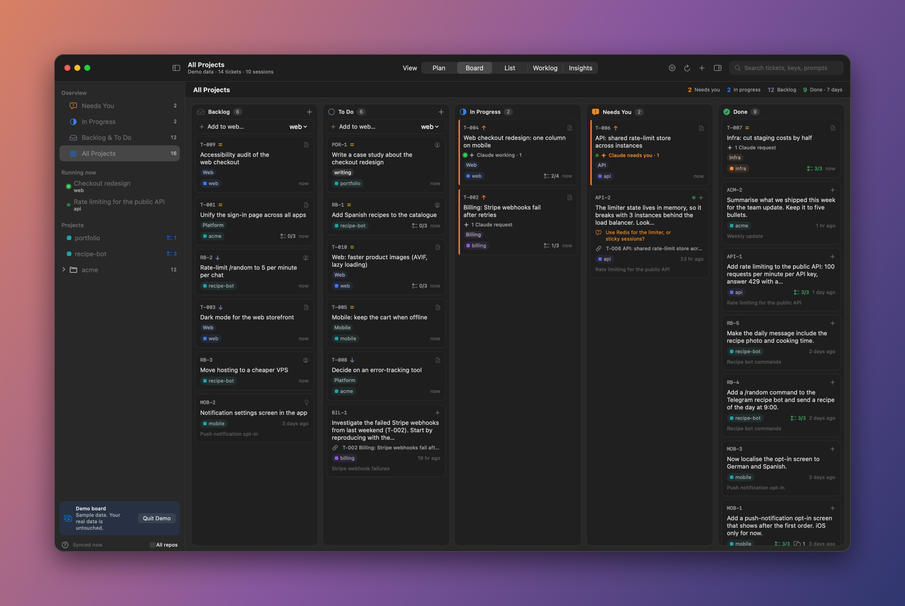
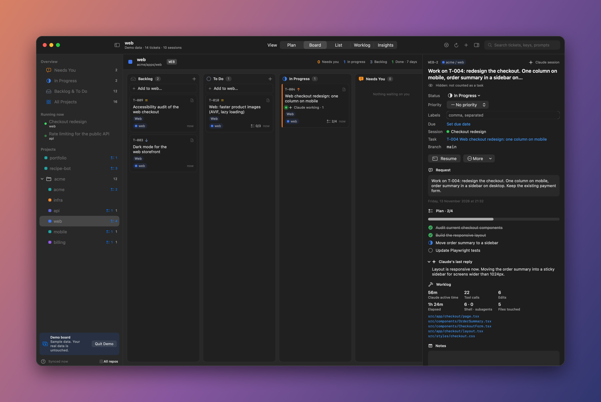
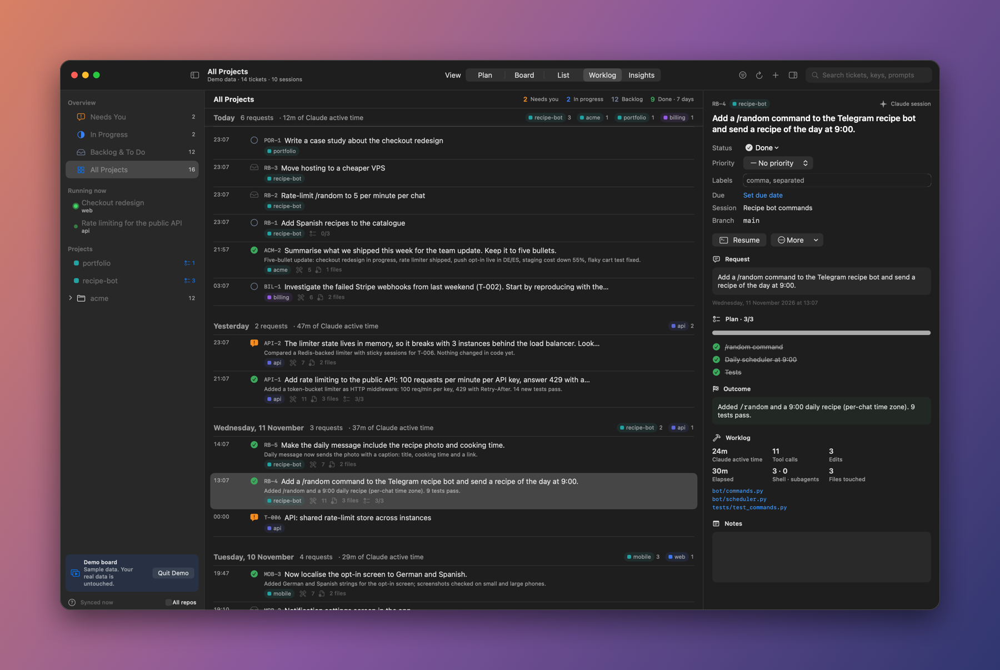
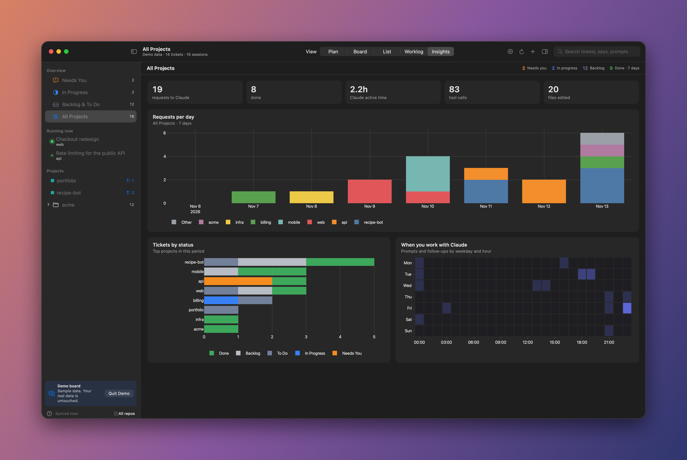

# ClaudeBoard guide

A walkthrough of everything ClaudeBoard does. The screenshots come from the built-in demo board,
so you can follow along without touching your own data: **Help → Try the Demo Board**, or
`ClaudeBoard --demo`.

- [1. Install and first launch](#1-install-and-first-launch)
- [2. Two kinds of tickets](#2-two-kinds-of-tickets)
- [3. The board](#3-the-board)
- [4. When Claude is waiting on you](#4-when-claude-is-waiting-on-you)
- [5. Plan your own tasks](#5-plan-your-own-tasks)
- [6. Connect tasks and Claude sessions](#6-connect-tasks-and-claude-sessions)
- [7. Worklog and Insights](#7-worklog-and-insights)
- [8. Backlog folders: tasks in the repo](#8-backlog-folders-tasks-in-the-repo)
- [9. Shortcuts](#9-shortcuts)
- [10. Privacy, data and troubleshooting](#10-privacy-data-and-troubleshooting)

## 1. Install and first launch

1. Download the latest release, unzip, and move `ClaudeBoard.app` to Applications.
2. The app is not notarized yet. The first time, right-click it and choose **Open**.
3. On the welcome screen, pick the folders that hold your code (e.g. `~/Developer`). Every git repo
   inside becomes a project. You can change them later in **Settings → Project roots**.
4. **Get Started** opens the in-app guide (also under **Help → ClaudeBoard Guide**, ⌘/).

ClaudeBoard needs Claude Code (the CLI or the desktop app's Code tab) used on the same Mac. It
reads Claude Code's local logs; there is nothing to configure in Claude itself.

## 2. Two kinds of tickets

| | Claude's work | Your tasks |
|---|---|---|
| Comes from | Every request you type in Claude Code | You: Plan view, board quick-add, ⌘N |
| Key | Per project, e.g. `WEB-12` | Backlog file id (`T-004`), or per project (`RB-1`) |
| Moves by itself | Yes: follows the session | No: you decide when it's done |
| Shows | Claude's plan, outcome, files touched, active time | Description, checklist, and Claude's work on it |

Short replies to Claude ("yes", "1", "go ahead") are folded into the ticket they answer, not
counted as new tickets.

## 3. The board



| Column | A Claude ticket lands here when… |
|---|---|
| **Backlog** | Claude suggested it as a follow-up (yours: you put it there) |
| **To Do** | You asked, but the session closed before Claude answered |
| **In Progress** | Claude is working right now, or its plan still has open steps |
| **Needs You** | Claude finished its turn with a question, or the session is blocked |
| **Done** | Claude finished and you moved on |

- **Moving cards:** drag a card to another column. A small hand icon marks columns you set
  yourself. **Use status from Claude** in the card's menu undoes it.
- **Live sessions:** a green dot means the session is open; a pulsing dot means Claude is busy.
- **Scope:** the sidebar picks what you see: everything, a workspace, or one project.
- **Period:** the toolbar filter hides Done tickets older than the chosen period. Open tickets
  always show.

## 4. When Claude is waiting on you


**Needs You** in the sidebar is your inbox. The details pane (⌘I) shows:
- Claude's question;
- the original request and the outcome so far;
- the worklog: active time, tool calls and files touched.

**Resume** reopens that session in Terminal (`claude --resume`) so you can answer.

## 5. Plan your own tasks


The **Plan** view (⌘1) lists each project with its open tasks:

- Type in **Add a task for …** and press Return. `!high`, `!urgent`, `!low` (or `!p0`–`!p3`) set
  priority.
- **⌘N** opens the full form: project, where to save, status, priority, area, labels, details and a
  "done when" checklist.
- A task row shows a ✦ count when Claude sessions have worked on it, and a live dot while Claude
  is working on it.

Where a task is saved:

- **This Mac:** kept in ClaudeBoard. Good for personal projects.
- **Backlog folder:** a markdown file in the repo. Teammates and Claude see the same list. See
  [section 8](#8-backlog-folders-tasks-in-the-repo).

## 6. Connect tasks and Claude sessions



- **Mention the key:** "work on T-004", "[RB-1] add Spanish recipes". The session links to the
  task, and the task's details list Claude's work on it with live status.
- **Start with Claude:** opens Terminal in the project folder and runs Claude Code with the
  task, key included. A backlog-file task is passed as "Work on T-004… read
  `backlog/tasks/T-004-….md` first", and Claude is asked to update its status when done.
- **Your task's status stays yours.** When Claude finishes, check the outcome and mark the task
  done.

## 7. Worklog and Insights



**Worklog** (⌘4) is a day-by-day list of what you asked and what Claude did, with active time per
day. Handy for stand-ups and timesheets.



**Insights** (⌘5) charts requests per day per project, tickets by status, and when in the week you
work with Claude.

## 8. Backlog folders: tasks in the repo

A backlog folder is plain markdown, one file per task:

```markdown
---
id: T-004
title: "Web checkout redesign: one column on mobile"
area: Web
project: apps/web      # optional; otherwise inferred from the title
priority: P1           # P0–P3, or urgent/high/medium/low
status: in-progress    # backlog · todo · in-progress · blocked · done
captured: 2026-11-04
---

# T-004 — Web checkout redesign: one column on mobile

Why it matters, what is unknown.

## Done when

- [x] Audit current components
- [ ] Order summary sidebar
```

- **Discovery:** folders named `backlog/`, `.backlog/` or `tasks/` inside your project roots are
  picked up automatically, with an optional `BACKLOG.md` index table. So is the
  [Backlog.md](https://github.com/MrLesk/Backlog.md) layout.
- **Creating one:** in a project's menu, choose **Keep Tasks in the Repo**. It creates `backlog/`
  with a README and an index, and moves the project's local tasks into it.
- **Which project a task belongs to:**
  1. the `project:` field, if set;
  2. otherwise, the first project named in `owner-session`, the title or the area;
  3. otherwise, the folder's own project.

  Add other names in **Project Settings → Also called** (e.g. "fe" for frontend).
- **Edits are surgical:** changing status, priority, title, labels, due date or a checkbox rewrites
  only that line in the file and its row in `BACKLOG.md`. Your git diffs stay clean.

## 9. Shortcuts

| Keys | Action |
|---|---|
| ⌘1 … ⌘5 | Plan, Board, List, Worklog, Insights |
| ⌘N | New task |
| ⌘R | Refresh now (it also refreshes every 20 s) |
| ⌘I | Show or hide details |
| ⇧⌘1 / ⇧⌘0 | Needs You / All Projects |
| ⌘/ | This guide, in the app |

The **menu bar** icon shows how many tickets need you and which sessions are busy, even with the
window closed.

## 10. Privacy, data and troubleshooting

- **Local only.** No account, no network requests. Claude Code's files are read, never changed.
- **Your edits** (overrides, local tasks, project settings) live in
  `~/Library/Application Support/ClaudeBoard/`. Backlog-file tasks live only in their markdown
  files.
- **Tickets look wrong after a Claude Code update?** The log format isn't a public API. Run
  `ClaudeBoard --dump 30` to see what the parser reads, and open an issue with your
  `claude --version`. Redact private prompts first.
- **Hide anything** that isn't a real task: **More → Hide from ClaudeBoard**. **Show hidden
  tickets** in the toolbar filter brings them back.
