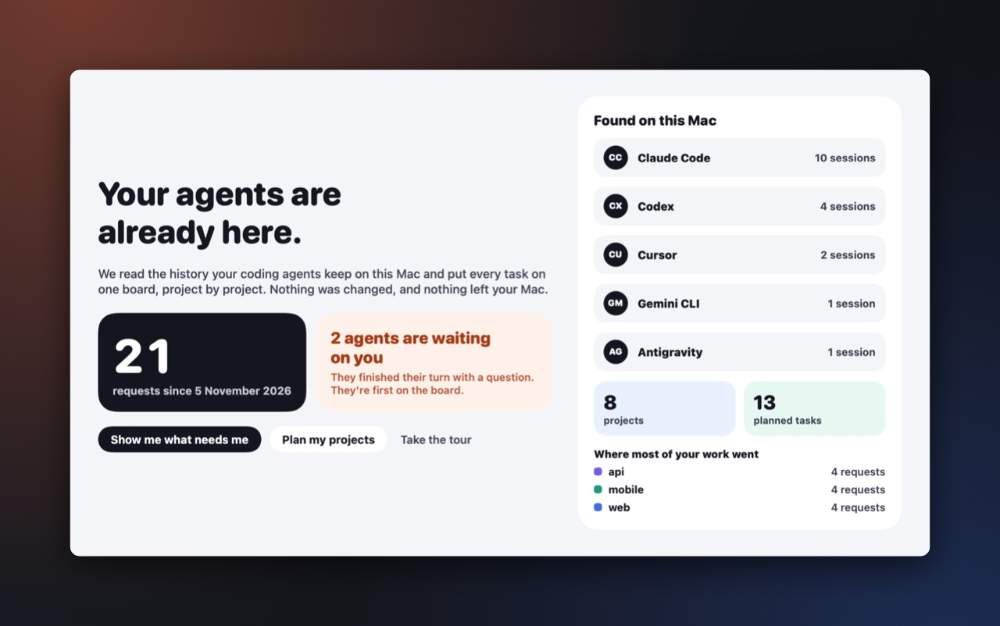
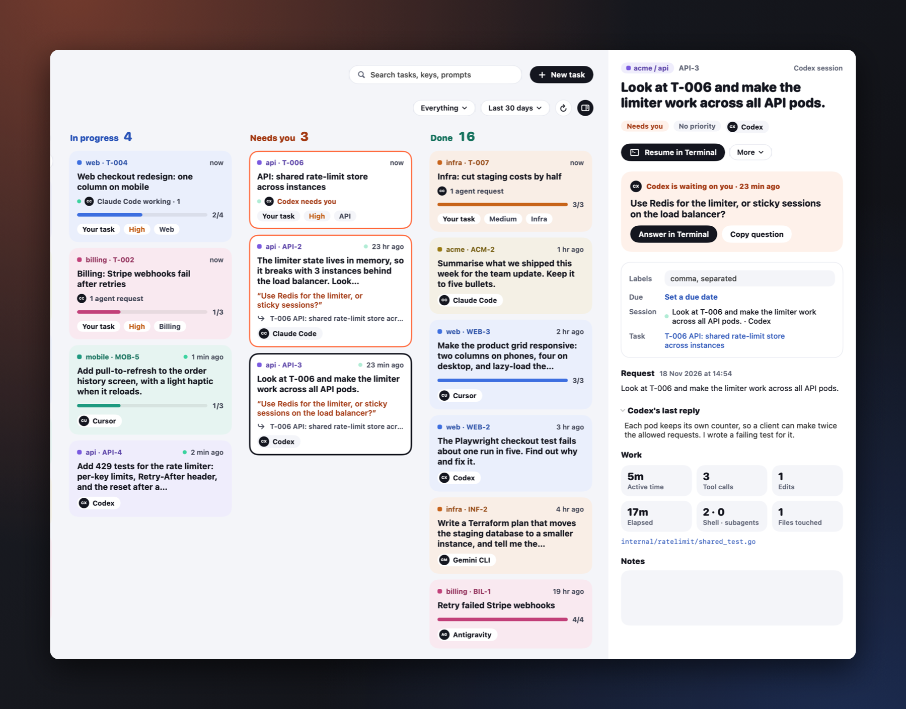
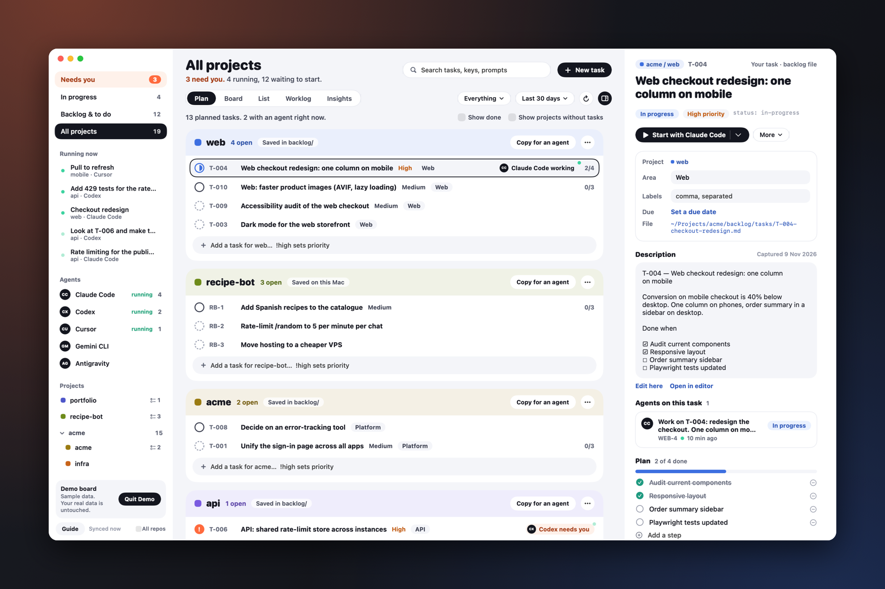
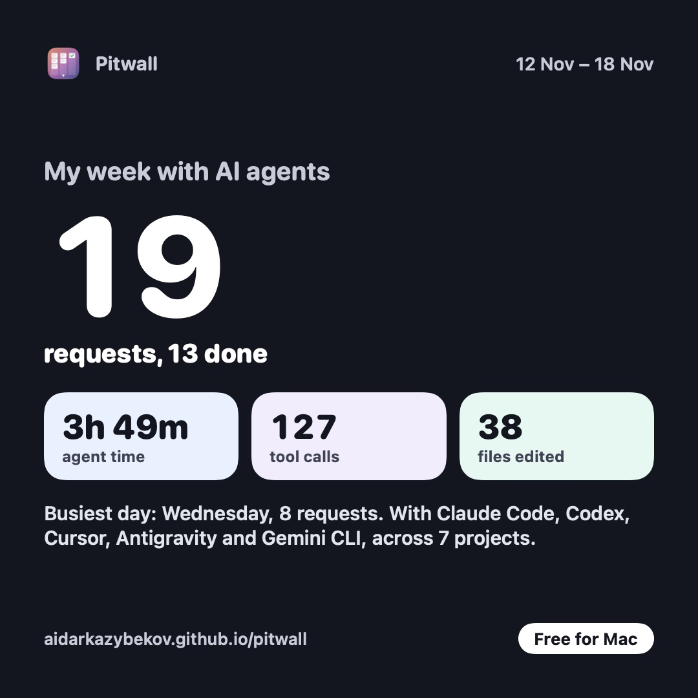

# Pitwall guide

A walkthrough of everything Pitwall does. The screenshots come from the built-in demo board,
so you can follow along without touching your own data: **Help → Try the Demo Board**, or
`Pitwall --demo`.

**Works with every agent you use.** Pitwall reads the local history of **Claude Code** and
**Codex** (CLI and desktop app), **Cursor**, **Gemini CLI** and **Antigravity**, and puts them on
one board, each ticket marked with the agent that did the work. Turn any agent off in **Settings →
Agents on this Mac**. Pitwall was called ClaudeBoard until 0.4; installing it over ClaudeBoard
keeps your tasks and settings.

- [1. Install and first launch](#1-install-and-first-launch)
- [2. Two kinds of tickets](#2-two-kinds-of-tickets)
- [3. The board](#3-the-board)
- [4. When an agent is waiting on you](#4-when-an-agent-is-waiting-on-you)
- [5. Plan your own tasks](#5-plan-your-own-tasks)
- [6. Connect tasks and agent sessions](#6-connect-tasks-and-agent-sessions)
- [7. Worklog and Insights](#7-worklog-and-insights)
- [8. Backlog folders: tasks in the repo](#8-backlog-folders-tasks-in-the-repo)
- [9. Shortcuts](#9-shortcuts)
- [10. Privacy, data and troubleshooting](#10-privacy-data-and-troubleshooting)

## 1. Install and first launch

1. Install it with one line in Terminal:
   `curl -fsSL https://aidarkazybekov.github.io/pitwall/install.sh | bash`.
   Run the same line again later to update.
2. Or download the zip, unzip it, and move `Pitwall.app` to Applications. The app isn't
   notarized yet: open it once, then click **Open Anyway** in **System Settings → Privacy &
   Security**. macOS 15 removed the right-click → Open shortcut.
3. On the welcome screen, pick the folders that hold your code (e.g. `~/Developer`). Every git repo
   inside becomes a project. You can change them later in **Settings → Project roots**.
4. **Get Started** shows what Pitwall found in your agents' history: which agents, how many requests,
   sessions and projects, where most of your work went, and which sessions are waiting on you
   right now. From there, jump straight to what needs you, plan your projects, or take the tour.
   See it again any time under **Help → What Pitwall Found**. The in-app guide is under
   **Help → Pitwall Guide** (⌘/).

   

Pitwall needs at least one agent used on the same Mac: Claude Code (the CLI or the desktop app's
Code tab), Codex, Cursor, Gemini CLI or Antigravity. It reads their local history; there is nothing
to configure in the agents themselves.

## 2. Two kinds of tickets

| | Your agents' work | Your tasks |
|---|---|---|
| Comes from | Every request you give any of your agents | You: Plan view, board quick-add, ⌘N |
| Key | Per project, e.g. `WEB-12` | Backlog file id (`T-004`), or per project (`RB-1`) |
| Moves by itself | Yes: follows the session | No: you decide when it's done |
| Shows | The agent's plan, outcome, files touched, active time | Description, checklist, and the agents' work on it |

Short replies to an agent ("yes", "1", "go ahead") are folded into the ticket they answer, not
counted as new tickets.

## 3. The board


| Column | An agent's ticket lands here when… |
|---|---|
| **Backlog** | The agent suggested it as a follow-up (yours: you put it there) |
| **To do** | You asked, but the session closed before the agent answered |
| **In progress** | The agent is working right now, or the session is open and its plan still has open steps |
| **Needs you** | The agent stopped with a question or a permission request in the last day, or the session is still open and waiting |
| **Done** | The agent finished and you moved on |

- **Moving cards:** drag a card to another column. A small hand icon marks columns you set
  yourself; your column holds until the agent does something new on that ticket.
  **Use status from the agent** in the card's menu undoes it.
- **Live sessions:** a green dot means the session is open; a pulsing dot means the agent is busy.
- **Scope:** the sidebar picks what you see: everything, a workspace, one project, or one agent.
- **Period:** the filter above the board hides Done tickets older than the chosen period, counted in
  whole days ("7 days" is today and the six before). Open tickets always show.

## 4. When an agent is waiting on you



**Needs you** in the sidebar is your inbox: every session that stopped on a question or a
permission prompt, whichever agent ran it. The details pane (⌘I) shows:
- the agent's question;
- the original request and the outcome so far;
- the worklog: active time, tool calls and files touched.

**Resume** takes you back to answer it: Claude Code and Codex reopen the same session in Terminal,
Gemini CLI opens in the project folder, and Cursor and Antigravity open the project.

### Notifications

You don't have to watch the board. When a session stops to ask you something, Pitwall sends
a macOS notification naming the agent and its question. Click it to open the ticket, or choose **Resume in
Terminal** to answer right away.

- **Settings → Notifications** has a toggle for "waiting on you" (on) and "an agent finished" (off).
  **Send a Test Notification** shows what one looks like.
- macOS asks for permission the first time one is sent, not at launch.
- Only real changes count: nothing at launch, never the same question twice, and a burst (say,
  after your Mac wakes up) arrives as one summary.

## 5. Plan your own tasks



The **Plan** view (⌘1) lists each project with its open tasks:

- Type in **Add a task for …** and press Return. `!high`, `!urgent`, `!low` (or `!p0`–`!p3`) set
  priority.
- **⌘N** opens the full form: project, where to save, status, priority, area, labels, details and a
  "done when" checklist.
- A task row shows a ✦ count when agent sessions have worked on it, and a live dot while an agent
  is working on it.

Where a task is saved:

- **This Mac:** kept in Pitwall. Good for personal projects.
- **Backlog folder:** a markdown file in the repo. Teammates and agents see the same list. See
  [section 8](#8-backlog-folders-tasks-in-the-repo).

## 6. Connect tasks and agent sessions


- **Mention the key:** "work on T-004", "[RB-1] add Spanish recipes". The session links to the
  task, and the task's details list every agent's work on it with live status.
- **Start with (any agent):** the button remembers the agent you used last; the arrow next to it
  picks another. Claude Code, Codex and Gemini CLI open in Terminal in the project folder with the
  task, key included. Cursor and Antigravity open the project, with the task on your clipboard. A backlog-file task is passed as "Work on T-004… read
  `backlog/tasks/T-004-….md` first", and the agent is asked to update its status when done.
- **Started from the task, shown through it.** A session started with "[T-004] …" doesn't get a
  separate card; it shows inside T-004. If it stops to ask you something, it still shows in
  **Needs you**, the menu bar and notifications.
- **Your task's status stays yours.** When an agent finishes, check the outcome and mark the task
  done.

## 7. Worklog and Insights


**Worklog** (⌘4) is a day-by-day list of what you asked and what each agent did, with active time per
day. Handy for stand-ups and timesheets.


**Insights** (⌘5) charts requests per day per project, tickets by status, which agent did the
work, and when in the week you work with them.

### Share your week



**Share Your Week** (in the Worklog, or ⇧⌘S) turns the last 7 days, this week or the last 30 days
into a recap card: requests, agent time, tool calls, files edited, what got done and your
busiest day. **Copy Image**, **Save PNG** or **Share** it.

- **Project names are hidden by default.** They can reveal client or private work; turn them on
  only if you want them on the card.
- **Prompt text is never included.**

## 8. Backlog folders: tasks in the repo

A backlog folder is plain markdown, one file per task:

```markdown
---
id: T-004
title: "Web checkout redesign: one column on mobile"
area: Web
project: apps/web      # optional; otherwise inferred from the title
priority: P1           # P0–P3, or urgent/high/medium/low
status: in-progress    # backlog · todo · in-progress · blocked · done
captured: 2026-11-04
---

# T-004 — Web checkout redesign: one column on mobile

Why it matters, what is unknown.

## Done when

- [x] Audit current components
- [ ] Order summary sidebar
```

- **Discovery:** folders named `backlog/`, `.backlog/` or `tasks/` inside your project roots are
  picked up automatically, with an optional `BACKLOG.md` index table. So is the
  [Backlog.md](https://github.com/MrLesk/Backlog.md) layout.
- **Creating one:** in a project's menu, choose **Keep Tasks in the Repo**. It creates `backlog/`
  with a README and an index, and moves the project's local tasks into it.
- **Which project a task belongs to:**
  1. the `project:` field, if set;
  2. otherwise, the first project named in `owner-session`, the title or the area;
  3. otherwise, the folder's own project.

  Add other names in **Project Settings → Also called** (e.g. "fe" for frontend).
- **Edits are surgical:** changing status, priority, title, labels, due date or a checkbox rewrites
  only that line in the file and its row in `BACKLOG.md`. Your git diffs stay clean.

## 9. Shortcuts

| Keys | Action |
|---|---|
| ⌘1 … ⌘5 | Plan, Board, List, Worklog, Insights |
| ⌘N | New task |
| ⌘R | Refresh now (it also refreshes every 20 s) |
| ⌘I | Show or hide details |
| ⇧⌘1 / ⇧⌘0 | Needs You / All Projects |
| ⇧⌘S | Share your week |
| ⌘/ | This guide, in the app |

The **menu bar** icon shows how many tickets need you, even with the window closed. Click it for
the sessions waiting on you, each with the agent's question and **Resume** / **Open**, the sessions
agents are working in, and today's requests, done and agent time (click those to open the
Worklog). Notifications reach you then too.

**Settings → Menu bar and startup:** turn on **Open Pitwall at login** and it starts quietly in
the menu bar, so notifications keep coming. Turn off **Show Pitwall in the Dock** to keep only
the menu bar icon. Closing the board window never quits Pitwall; quit from the menu bar or ⌘Q.

## 10. Privacy, data and troubleshooting

- **Local only.** No account, no network requests. Your agents' files are read, never changed.
- **Your edits** (overrides, local tasks, project settings) live in
  `~/Library/Application Support/Pitwall/`. Backlog-file tasks live only in their markdown
  files.
- **Tickets look wrong after an agent update?** None of the history formats is a public API. Run
  `Pitwall --dump 30` to see what the readers see, and open an issue with the agent and its
  version. Redact private prompts first.
- **Hide anything** that isn't a real task: **More → Hide from Pitwall**. **Show hidden
  tickets** in the toolbar filter brings them back.
